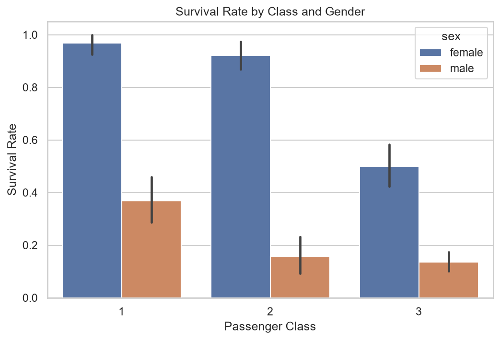
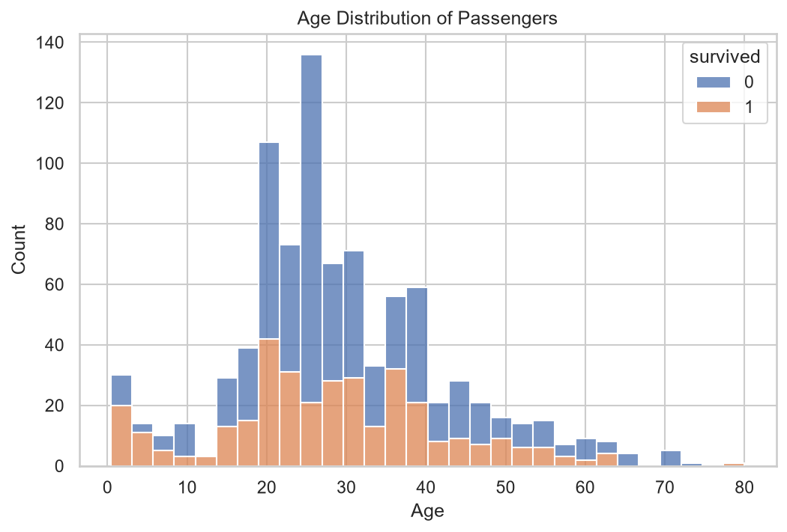
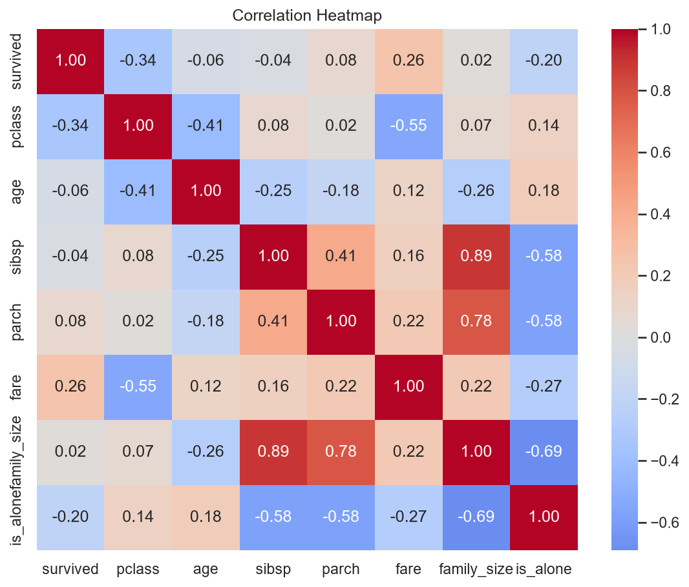

# Titanic Dataset – Exploratory Data Analysis (EDA)

Exploratory analysis of the Titanic passenger dataset using Python (Pandas, Seaborn, Matplotlib).
The goal is to understand which factors influenced passenger survival.

## Data Source
- **Dataset:** Titanic (891 passengers)
- **URL:** https://github.com/mwaskom/seaborn-data/blob/master/titanic.csv
- **Loaded via:** `sns.load_dataset('titanic')`
- **Extraction date:** 14 October 2026

## What's in this Repo
| File | Description |
|---|---|
| `titanic_eda.ipynb` | Full analysis notebook (cleaning, feature engineering, charts, observations) |
| `titanic_cleaned.csv` | Cleaned dataset |
| `charts/` | Exported PNG charts |
| `insights.md` | Short summary of key findings |

## Data Cleaning
- **age:** 177 missing values filled with the median age by sex and passenger class.
- **deck:** dropped (~77% missing).
- **embarked / embark_town:** 2 missing values filled with the most common value.

## Feature Engineering
- `family_size = sibsp + parch + 1`
- `is_alone`: 1 if travelling alone
- `age_group`: Child, Teen, Young Adult, Adult, Senior

## Charts

### Survival Rate by Class and Gender


### Age Distribution


### Correlation Heatmap


## Key Findings
See [insights.md](insights.md) for the full summary.

## How to Run
1. Install the requirements:
```
   pip install pandas seaborn matplotlib
```
2. Open `titanic_eda.ipynb` in Jupyter and run all cells.
   The dataset is fetched automatically (internet connection required).
   Alternatively, use `titanic_cleaned.csv` directly.
